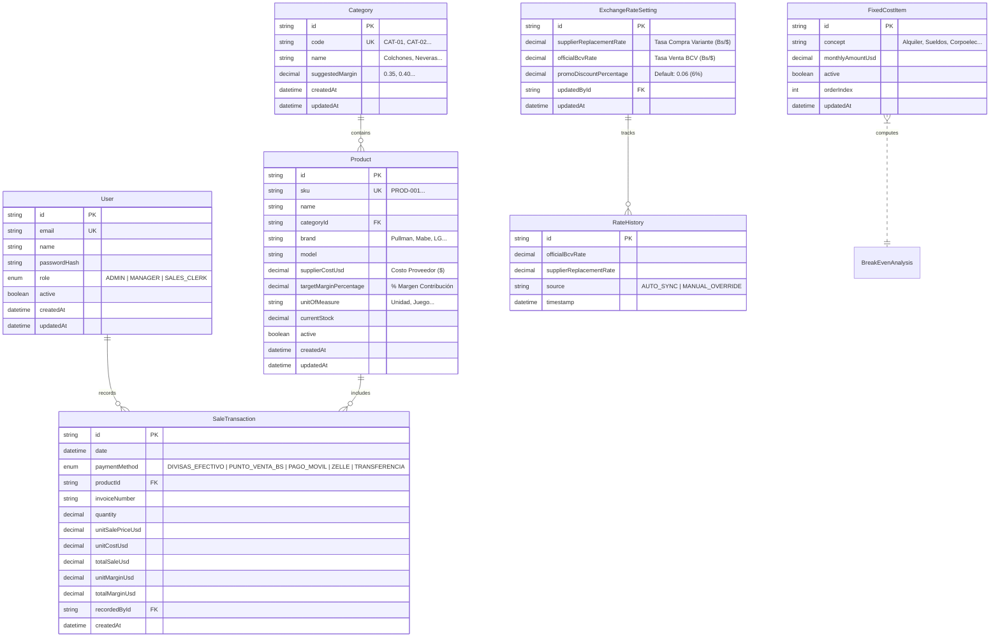

# Data Model: Mercantil Mariana Bi-Monetary Pricing System

**Feature**: `001-sales-price-control`
**Date**: 2026-11-05
**Status**: Draft

## 1. Entity-Relationship Overview

---

## 2. Entity Specifications & Validation Rules

### 2.1 User
Represents system operators with credentials and access roles.

| Field | Type | Modifiers | Description & Validation |
|-------|------|-----------|--------------------------|
| `id` | `String` | `@id @default(cuid())` | Unique identifier |
| `email` | `String` | `@unique` | Valid email address format |
| `name` | `String` | | Display name of the operator |
| `passwordHash` | `String` | | Bcrypt salted hash |
| `role` | `UserRole` | `default(SALES_CLERK)` | `ADMIN`, `MANAGER`, `SALES_CLERK` |
| `active` | `Boolean` | `default(true)` | Soft disable flag |
| `createdAt` | `DateTime` | `@default(now())` | Creation timestamp |
| `updatedAt` | `DateTime` | `@updatedAt` | Last modification |

**Validation Rules**:
- Email must be valid and lowercase.
- Only users with role `ADMIN` can create or modify other users.

---

### 2.2 ExchangeRateSetting & RateHistory
Represents active and historical bi-monetary conversion parameters.

| Field | Type | Modifiers | Description & Validation |
|-------|------|-----------|--------------------------|
| `id` | `String` | `@id @default(cuid())` | Unique identifier (singleton active record) |
| `supplierReplacementRate` | `Decimal` | `@db.Decimal(12, 4)` | Tasa Compra Variante (Bs/$). Must be > 0. |
| `officialBcvRate` | `Decimal` | `@db.Decimal(12, 4)` | Tasa Venta Oficial BCV (Bs/$). Must be > 0. |
| `promoDiscountPercentage` | `Decimal` | `@db.Decimal(5, 4)` | Default `0.06` (6%). Range: 0.00 to 0.50. |
| `updatedAt` | `DateTime` | `@updatedAt` | Timestamp of last rate update |

**Business Rules**:
- The system must prevent `officialBcvRate <= 0` or `supplierReplacementRate <= 0` to prevent division-by-zero errors.
- Whenever rates change, an immutable audit entry is appended to `RateHistory`.

---

### 2.3 Category
Master groupings for catalog merchandise.

| Field | Type | Modifiers | Description & Validation |
|-------|------|-----------|--------------------------|
| `id` | `String` | `@id @default(cuid())` | Unique identifier |
| `code` | `String` | `@unique` | e.g., `CAT-01`, `CAT-02` |
| `name` | `String` | | Category title |
| `suggestedMargin` | `Decimal` | `@db.Decimal(5, 4)` | Suggested profit margin (e.g., `0.35` for 35%) |

---

### 2.4 Product
Commercial catalog items with base supplier costs and target margins.

| Field | Type | Modifiers | Description & Validation |
|-------|------|-----------|--------------------------|
| `id` | `String` | `@id @default(cuid())` | Unique identifier |
| `sku` | `String` | `@unique` | e.g., `PROD-001`, `PROD-002` |
| `name` | `String` | | Product title / description |
| `categoryId` | `String` | `FK -> Category.id` | Category relationship |
| `brand` | `String` | | Manufacturer / Brand |
| `model` | `String` | | Model name or number |
| `supplierCostUsd` | `Decimal` | `@db.Decimal(10, 2)` | Replacement cost from supplier ($). Must be >= 0. |
| `targetMarginPercentage` | `Decimal` | `@db.Decimal(5, 4)` | Target margin (e.g. 0.50 for 50%). Must be < 1.0. |
| `unitOfMeasure` | `String` | `default("Unidad")` | Unit, Set, etc. |
| `currentStock` | `Decimal` | `@default(0)` | Physical stock on hand |
| `active` | `Boolean` | `default(true)` | Active status in catalog |

---

### 2.5 SaleTransaction
Chronological commercial register of customer transactions.

| Field | Type | Modifiers | Description & Validation |
|-------|------|-----------|--------------------------|
| `id` | `String` | `@id @default(cuid())` | Unique identifier |
| `date` | `DateTime` | `@default(now())` | Transaction date |
| `paymentMethod` | `PaymentMethod` | | Enum: Cash USD, Point of Sale, Mobile Pay, Zelle, Bank Wire |
| `productId` | `String` | `FK -> Product.id` | Linked product |
| `invoiceNumber` | `String?` | | Optional legal invoice / receipt code |
| `quantity` | `Decimal` | `@db.Decimal(10, 2)` | Units sold (Must be > 0) |
| `unitSalePriceUsd` | `Decimal` | `@db.Decimal(10, 2)` | Unit price billed in USD equivalent |
| `unitCostUsd` | `Decimal` | `@db.Decimal(10, 2)` | Product unit cost at moment of sale |
| `totalSaleUsd` | `Decimal` | `@db.Decimal(10, 2)` | `quantity * unitSalePriceUsd` |
| `unitMarginUsd` | `Decimal` | `@db.Decimal(10, 2)` | `unitSalePriceUsd - unitCostUsd` |
| `totalMarginUsd` | `Decimal` | `@db.Decimal(10, 2)` | `quantity * unitMarginUsd` |
| `recordedById` | `String` | `FK -> User.id` | Operator who logged the sale |

---

### 2.6 FixedCostItem
Monthly recurring operational overhead expenses.

| Field | Type | Modifiers | Description & Validation |
|-------|------|-----------|--------------------------|
| `id` | `String` | `@id @default(cuid())` | Unique identifier |
| `concept` | `String` | | Concept (Rent, Salaries, Electric, Internet, etc.) |
| `monthlyAmountUsd` | `Decimal` | `@db.Decimal(10, 2)` | Cost per month in USD (Must be >= 0) |
| `active` | `Boolean` | `default(true)` | Include in break-even formula |
| `orderIndex` | `Int` | `default(0)` | Display sort order |
