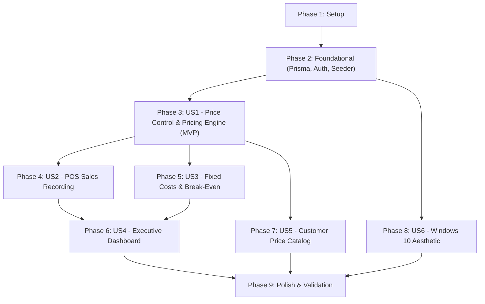

# Tasks: Mercantil Mariana Bi-Monetary Sales Price Control & Financial Management System

**Input**: Design documents from `/specs/001-sales-price-control/` (`spec.md`, `plan.md`, `research.md`, `data-model.md`, `contracts/`, `quickstart.md`)

**Prerequisites**: `plan.md`, `spec.md`, `data-model.md`, `contracts/`

**Organization**: Tasks are grouped by user story to enable independent implementation and testing of each story in priority order (P1 to P6).

---

## Phase 1: Setup (Shared Infrastructure)

**Purpose**: Project initialization, dependency installation, styling setup, and logo integration

- [X] T001 Initialize Next.js 14+ TypeScript project with App Router and Tailwind CSS in `package.json`
- [X] T002 [P] Configure TypeScript compiler paths and strict options in `tsconfig.json`
- [X] T003 [P] Configure Tailwind CSS with Windows 10 system theme and Excel spreadsheet color palette (`#274E13`, `#38761D`, `#00A758`, `#E2F0D9`, `#FBE3D6`, `#494949`, `#F3F3F3`) in `tailwind.config.ts`
- [X] T004 [P] Set up environment configuration templates and validation in `.env.example` and `src/lib/env.ts`
- [X] T005 [P] Verify and place Mercantil Mariana corporate logo asset at `public/logo.jpg`
- [X] T006 [P] Configure Vitest unit testing harness in `vitest.config.ts`

---

## Phase 2: Foundational (Blocking Prerequisites)

**Purpose**: Core infrastructure, database schema, Prisma ORM, authentication, and Excel workbook data seeder

**⚠️ CRITICAL**: No user story work can begin until this foundational phase is complete

- [X] T007 Define Prisma relational schema with `User` (`role: ADMIN | MANAGER | SALES_CLERK`), `ExchangeRateSetting` (`supplierReplacementRate`, `officialBcvRate > 0`, `promoDiscountPercentage: default 0.06`), `RateHistory`, `Category` (`suggestedMargin`), `Product` (`supplierCostUsd >= 0`, `targetMarginPercentage < 1.0`), `SaleTransaction` (`quantity > 0`), and `FixedCostItem` (`monthlyAmountUsd >= 0`) in `prisma/schema.prisma`
- [X] T008 Generate Prisma client and initialize database connection pool in `src/lib/db.ts`
- [X] T009 [P] Implement role-based session and JWT authentication helpers in `src/lib/auth.ts`
- [X] T010 [P] Implement authentication login endpoint handler `POST /api/auth/login` and session validation in `src/app/api/auth/login/route.ts`
- [X] T011 Implement automated Excel data extraction and database seeder script using `xlsx` (SheetJS) to import products, categories, fixed costs, and initial rates from `CONTROL_DE_PRECIOS_DE_VENTA (4).xlsx` in `scripts/seed-from-excel.ts`
- [X] T012 Implement desktop Windows 10 application shell layout with title bar, window control glyphs, ribbon tabs, and active exchange rate status bar in `src/components/layout/AppShell.tsx`

**Checkpoint**: Foundation ready - Database, seeder, auth, and base desktop UI framework in place.

---

## Phase 3: User Story 1 - Real-Time Exchange Rate & Dynamic Price Calculation (Priority: P1) 🎯 MVP

**Goal**: Commercial managers can update rates (BCV and replacement) and profit margins with instant recalculation of unit costs, BCV prices, Bolívares prices, and promo dollar prices matching Excel formulas.

**Independent Test**: Update exchange rates to 970.00 (Tasa Compra) and 849.56 (Tasa BCV) with product cost $180 and margin 50%, verifying that unit cost ($158), BCV price ($316 / 268,461 Bs), cash promo ($277), and promo 2 ($261) match reference calculations identically.

### Tests for User Story 1
- [X] T013 [P] [US1] Unit tests for financial formulas (`Factor de Cambio`, `ROUNDUP`, `Costo Unitario`, `Precio BCV`, `Precio Bs`, `Margen Bruto Bs`, `Promo Divisas`, `Promo Divisas 2`) against Excel benchmark values in `tests/unit/pricing-engine.test.ts`

### Implementation for User Story 1
- [X] T014 [US1] Implement pure pricing calculation engine with integer upward rounding (`ROUNDUP`) in `src/lib/pricing-engine.ts`
- [X] T015 [P] [US1] Implement automated BCV rate fetcher service with fallback scraping in `src/lib/bcv-service.ts`
- [X] T016 [US1] Implement exchange rate API route handlers `GET /api/rates`, `PUT /api/rates`, and `POST /api/rates/sync` in `src/app/api/rates/route.ts` and `src/app/api/rates/sync/route.ts`
- [X] T017 [US1] Implement products and pricing API route handlers `GET /api/products` and `PUT /api/products/[id]` in `src/app/api/products/route.ts` and `src/app/api/products/[id]/route.ts`
- [X] T018 [P] [US1] Implement exchange rate update modal dialog with manual override controls in `src/components/pricing/RateUpdateModal.tsx`
- [X] T019 [US1] Implement Control de Precios interactive data table with in-place margin and cost editing in `src/components/pricing/PriceControlTable.tsx`
- [X] T020 [US1] Build the Price Control page view integrating rates, real-time client recalculation, and category filtering in `src/app/(dashboard)/control-precios/page.tsx`

**Checkpoint**: User Story 1 fully functional as standalone MVP. Bi-monetary pricing and exchange rate recalibration operates with 100% mathematical parity.

---

## Phase 4: User Story 2 - Point of Sale Sales Recording & Real-Time Margin Tracking (Priority: P2)

**Goal**: Sales clerks and managers can record customer transactions with payment method, invoice number, quantity, and applied prices, computing cost and margins automatically into the commercial ledger.

**Independent Test**: Register a sale for 2 units of an item with unit cost $158 and sale price $277; verify total sale is $554, unit margin is $119, and total margin is $238 in the transaction history.

### Implementation for User Story 2
- [X] T021 [US2] Implement sales transaction API route handlers `GET /api/sales` and `POST /api/sales` with validation in `src/app/api/sales/route.ts`
- [X] T022 [P] [US2] Implement new sale registration modal form with catalog autocomplete, payment method dropdown, and automatic margin preview in `src/components/sales/SalesFormModal.tsx`
- [X] T023 [P] [US2] Implement sales transaction history table with date range filtering and totals calculation in `src/components/sales/SalesHistoryTable.tsx`
- [X] T024 [US2] Build the Sales Registry page view linking transaction input and historical sales ledger in `src/app/(dashboard)/registro-ventas/page.tsx`

**Checkpoint**: User Stories 1 AND 2 functional. Commercial sales can be recorded and historical gross profits are tracked.

---

## Phase 5: User Story 3 - Operational Break-Even & Fixed Cost Structure Analysis (Priority: P3)

**Goal**: Business owners can manage monthly fixed costs ($1,600 baseline across 10 concepts) and dynamically compute daily and monthly break-even sales revenue targets in USD and Bolívares.

**Independent Test**: Enter 10 fixed operational costs totaling $1,600.00 and verify that for an average margin of 4.58%, monthly equilibrium sales target is ~$34,954.95 and daily target is ~$1,165.17.

### Implementation for User Story 3
- [X] T025 [US3] Implement break-even calculation functions in `src/lib/pricing-engine.ts`
- [X] T026 [US3] Implement fixed costs and break-even API route handlers `GET /api/break-even` and `PUT /api/break-even` in `src/app/api/break-even/route.ts`
- [X] T027 [P] [US3] Implement operational fixed costs editable table with monthly amount in USD and auto-calculated Bolívares in `src/components/break-even/FixedCostsTable.tsx`
- [X] T028 [P] [US3] Implement break-even target summary cards (Monthly Equilibrium and Daily Minimum in $ and Bs) in `src/components/break-even/BreakEvenCard.tsx`
- [X] T029 [US3] Build the Punto de Equilibrio page view integrating fixed cost management and equilibrium targets in `src/app/(dashboard)/punto-equilibrio/page.tsx`

**Checkpoint**: User Stories 1, 2, and 3 functional. Break-even operational analysis dynamically recalibrates against fixed expenses and catalog margins.

---

## Phase 6: User Story 4 - Executive Profitability Dashboard & 12-Month Performance (Priority: P4)

**Goal**: Executives can view KPI cards (Daily, Weekly, Monthly, Annual Gross Profit vs Monthly Fixed Costs and Net Income) and an annual 12-month consolidated performance matrix.

**Independent Test**: Query dashboard summary and verify that Daily Profit, Rolling 7-Day Profit, Monthly Profit, Annual Profit, and Monthly Net Income match aggregated transaction margins minus fixed costs.

### Implementation for User Story 4
- [X] T030 [US4] Implement executive metrics aggregation service in `src/lib/dashboard-service.ts`
- [X] T031 [US4] Implement dashboard summary API route handler `GET /api/dashboard/summary` in `src/app/api/dashboard/summary/route.ts`
- [X] T032 [P] [US4] Implement top executive KPI metric cards with status indicator badges in `src/components/dashboard/KpiCardsGrid.tsx`
- [X] T033 [P] [US4] Implement 12-month annual consolidated table (Ventas Totales, Utilidad Bruta, Costos Fijos, Utilidad Neta, Margen Neto %) in `src/components/dashboard/ConsolidatedMonthTable.tsx`
- [X] T034 [US4] Build the Executive Dashboard page view combining KPI cards and annual table in `src/app/(dashboard)/resumen-ganancias/page.tsx`

**Checkpoint**: User Stories 1 through 4 functional. High-level profitability intelligence and historical comparisons operational.

---

## Phase 7: User Story 5 - Public & Printable Sales Price Catalog (Priority: P5)

**Goal**: Sales agents can consult and print a clean customer-facing price catalog with official BCV prices and promotional cash prices while keeping internal supplier costs and margins hidden.

**Independent Test**: Open the price catalog as a Sales Clerk, verify supplier cost and margin columns are absent, test instant search/category filtering, and verify print stylesheet formats cleanly on Letter/A4 paper.

### Implementation for User Story 5
- [X] T035 [US5] Implement customer price catalog table with search and category filters in `src/components/catalog/PublicPriceTable.tsx`
- [X] T036 [P] [US5] Implement dedicated print stylesheet optimizing table layout for Letter/A4 printing with Mercantil Mariana header and date stamp in `src/styles/print.css`
- [X] T037 [US5] Build the Lista de Precios page view with quick category chips, search bar, and print action in `src/app/(dashboard)/lista-precios/page.tsx`

**Checkpoint**: User Stories 1 through 5 functional. Customer-facing price quotes and printable lists can be generated safely by sales staff.

---

## Phase 8: User Story 6 - Windows 10 & Excel Green Aesthetic Interface (Priority: P6)

**Goal**: Ensure authentic Windows 10 desktop application feel across all views, utilizing the Excel corporate green palette (`#274E13`, `#38761D`, `#00A758`, `#E2F0D9`, `#FBE3D6`, `#494949`), dense table typography, and company logo.

**Independent Test**: Inspect all application views on desktop; verify window header with Mercantil Mariana emblem, clean ribbon bar, Segoe UI typography, dense tabular borders, and bottom system status bar showing active currency rates.

### Implementation for User Story 6
- [X] T038 [US6] Refine Windows 10 title bar component with authentic minimize, maximize, close buttons and Mercantil Mariana brand badge in `src/components/layout/WindowTitleBar.tsx`
- [X] T039 [P] [US6] Refine Windows 10 ribbon navigation bar with crisp tabs, icons, and keyboard shortcuts in `src/components/layout/AppRibbon.tsx`
- [X] T040 [P] [US6] Refine Windows 10 status bar showing active exchange rates, database connectivity status, and logged-in user role in `src/components/layout/AppStatusBar.tsx`
- [X] T041 [US6] Apply Excel color tokens (`#274E13`, `#38761D`, `#00A758`, `#E2F0D9`, `#FBE3D6`, `#494949`) and dense border styling across table components in `src/app/globals.css`

**Checkpoint**: Windows 10 desktop application look and feel complete across all 5 operational views.

---

## Phase 9: Polish & Cross-Cutting Concerns

**Purpose**: Route protection, security hardening, end-to-end validation, and Vercel deployment readiness

- [X] T042 [P] Implement authentication middleware protecting administrative routes based on user role (`ADMIN`, `MANAGER`, `SALES_CLERK`) in `src/middleware.ts`
- [X] T043 Implement login interface with Windows 10 lock-screen aesthetic in `src/app/(auth)/login/page.tsx`
- [X] T044 [P] Run unit test suite to verify 100% calculation parity against Excel test vectors (`npm run test`)
- [X] T045 Execute end-to-end quickstart validation scenarios documented in `specs/001-sales-price-control/quickstart.md`
- [X] T046 [P] Verify production build and Vercel serverless deployment bundle (`npm run build`)

---

## Dependencies & Execution Order

### Phase Dependencies



- **Setup (Phase 1)**: Can start immediately.
- **Foundational (Phase 2)**: Depends on Phase 1. Blocks all user stories.
- **User Story 1 (P1 - MVP)**: Depends on Phase 2. Core pricing calculation engine.
- **User Story 2 (P2)**: Depends on US1 (uses calculated product costs for sales).
- **User Story 3 (P3)**: Depends on US1 (uses average catalog margin).
- **User Story 4 (P4)**: Depends on US2 (sales margins) and US3 (fixed costs).
- **User Story 5 (P5)**: Depends on US1 (uses calculated prices).
- **User Story 6 (P6)**: Enhances all views; can run in parallel with US2-US5.
- **Polish (Phase 9)**: Final integration, route protection, build check, and quickstart verification.

---

## Parallel Execution Examples

### Parallel Example: User Story 1
```bash
# Launch test suite and independent modules in parallel:
Task T013: "Unit tests in tests/unit/pricing-engine.test.ts"
Task T015: "Automated BCV rate fetcher in src/lib/bcv-service.ts"
Task T018: "Rate update modal dialog in src/components/pricing/RateUpdateModal.tsx"
```

### Parallel Example: User Story 2 & 3
```bash
# Once US1 is complete, US2 and US3 can proceed in parallel:
Developer A: US2 (Sales transaction API and POS forms: T021, T022, T023, T024)
Developer B: US3 (Fixed costs and break-even tables: T025, T026, T027, T028, T029)
```

---

## Implementation Strategy

### MVP First (User Story 1 Only)
1. Complete Phase 1 (Setup) and Phase 2 (Foundational).
2. Complete Phase 3 (User Story 1: Exchange Rates, Pricing Engine, and Price Control Table).
3. **Validate**: Test rate adjustments (970.00 / 849.56) and verify product prices match Excel identically.

### Incremental Delivery
- **Release 1 (MVP)**: Rates and Price Control (`control-precios`).
- **Release 2**: Customer Price List (`lista-precios`) and POS Sales Recording (`registro-ventas`).
- **Release 3**: Fixed Costs & Break-Even Analysis (`punto-equilibrio`).
- **Release 4**: Executive Profitability Dashboard (`resumen-ganancias`) and full Windows 10 polish.
