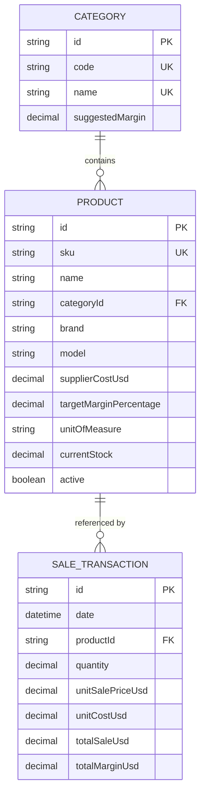
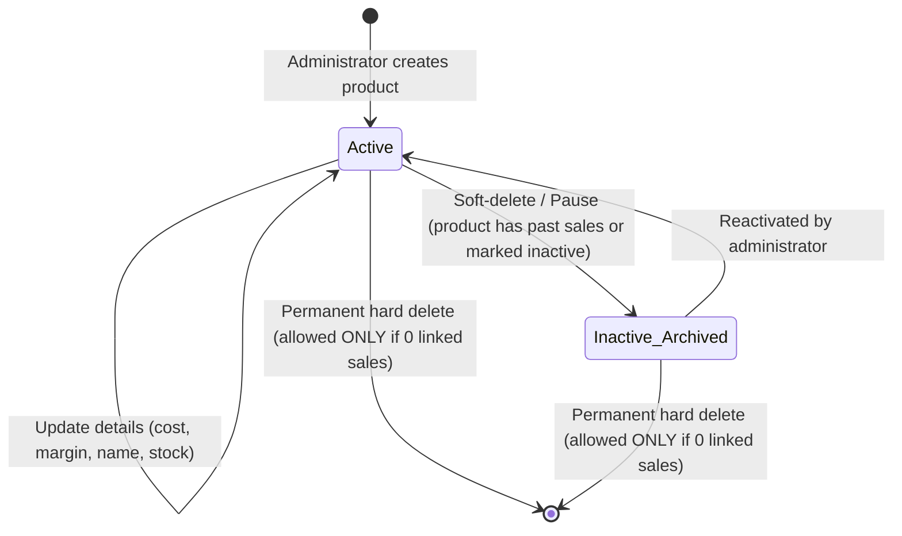

# Data Model: Product Lifecycle & Dynamic Catalog Management

**Feature**: `003-product-management`  
**Date**: 2026-11-06  
**Status**: Ready for Planning  

---

## 1. Entities & Fields

### Product Entity
Represents an individual sellable merchandise item within Mercantil Mariana.

| Field Name | Type | Nullable | Default | Description / Constraints |
| :--- | :--- | :---: | :---: | :--- |
| `id` | String (CUID/UUID) | No | `cuid()` | Unique primary key identifier |
| `sku` | String | No | — | Stock Keeping Unit (e.g. `PROD-001`, `COL-01`). Must be unique across all products. |
| `name` | String | No | — | Full commercial product description (e.g., "Colchón Matrimonial Ortopédico"). |
| `categoryId` | String | No | — | Foreign key pointing to `Category.id`. |
| `brand` | String | No | `""` | Manufacturer / brand name (e.g., "Simmons", "Mabe", "Oster"). |
| `model` | String | No | `""` | Model number or specification details. |
| `supplierCostUsd` | Decimal(10,2) | No | `0.00` | Base purchase/acquisition cost from supplier in USD. Must be > 0. |
| `targetMarginPercentage` | Decimal(5,4) | No | `0.35` | Contribution margin as a decimal ratio (e.g., 0.35 represents 35%). Must be >= 0 and <= 1.0. |
| `unitOfMeasure` | String | No | `"Unidad"` | Packaging / counting unit (e.g., "Unidad", "Juego", "Caja", "Par"). |
| `currentStock` | Decimal(10,2) | No | `0.00` | Physical stock count available in store. Must be >= 0. |
| `active` | Boolean | No | `true` | Product status flag: `true` = active in POS and public catalog; `false` = archived / discontinued. |
| `createdAt` | DateTime | No | `now()` | Timestamp of creation. |
| `updatedAt` | DateTime | No | auto | Timestamp of latest modification. |

### Category Entity
Groups products by commercial department or product line with a suggested default margin.

| Field Name | Type | Nullable | Default | Description / Constraints |
| :--- | :--- | :---: | :---: | :--- |
| `id` | String (CUID/UUID) | No | `cuid()` | Unique primary key identifier |
| `code` | String | No | — | Category code identifier (e.g., `CAT-01`). Unique. |
| `name` | String | No | — | Commercial category name (e.g., "Colchonería", "Línea Blanca"). Unique. |
| `suggestedMargin` | Decimal(5,4) | No | `0.35` | Default suggested margin for newly created products in this category. |
| `createdAt` | DateTime | No | `now()` | Creation timestamp. |
| `updatedAt` | DateTime | No | auto | Modification timestamp. |

---

## 2. Relationships

- **Category to Product**: One-to-Many (`1:N`). A category has many products. Each product belongs to exactly one category.
- **Product to SaleTransaction**: One-to-Many (`1:N`). A product can be referenced by multiple historical sales. If a product has references in `SaleTransaction`, hard deletion is prevented to protect accounting referential integrity.

---

## 3. State Transitions

### State Definitions
1. **Active (`active = true`)**:
   - Visible in `/control-precios` (Price Control).
   - Visible in `/lista-precios` (Public Price List).
   - Selectable in `/registro-ventas` (POS Sales Registration Modal).
   - Recalculates dynamically when exchange rates change.
2. **Inactive / Archived (`active = false`)**:
   - Hidden from public catalog and POS item pickers.
   - Visible only in `/control-precios` when filter "Mostrar Archivados" is enabled.
   - Preserves all past sales linkages and financial records.
3. **Deleted**:
   - Removed permanently from database/cache.
   - Only permitted if transaction count `sales.length === 0`.

---

## 4. Validation Rules

- **SKU**: Required, non-empty, unique across the catalog, alphanumeric and hyphen/underscore allowed (normalized to uppercase, trimmed).
- **Name**: Required, minimum length 3 characters, maximum length 150 characters.
- **Category**: Required. If category does not exist, system creates it automatically with code `CAT-XX`.
- **Supplier Cost (USD)**: Required, numeric value `> 0`.
- **Target Margin**: Required, numeric ratio between `0.00` (0%) and `1.00` (100%).
- **Current Stock**: Numeric value `>= 0`.
- **Unit of Measure**: Required, default "Unidad" (e.g., "Unidad", "Docena", "Kg", "Metro").
