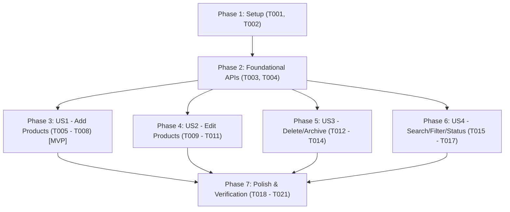

# Tasks: Product Lifecycle & Dynamic Catalog Management

**Input**: Design documents from `specs/003-product-management/`  
**Prerequisites**: `plan.md`, `spec.md`, `data-model.md`, `contracts/products-api.md`, `contracts/ui-contracts.md`, `quickstart.md`  

## Format: `- [ ] [TaskID] [P?] [Story?] Description with file path`

- **[P]**: Parallelizable task (independent file / module, no unfinished dependencies)
- **[Story]**: User story identifier (`[US1]`, `[US2]`, `[US3]`, `[US4]`)
- Every task includes an explicit, concrete file path.

---

## Phase 1: Setup (Shared Infrastructure)

**Purpose**: Shared types, interfaces, and testing infrastructure for product catalog management.

- [X] T001 [P] Create TypeScript interfaces for product CRUD operations, form payloads, and API responses in `src/lib/types/product.ts`
- [X] T002 [P] Setup automated test suite for product validation, pricing derivation, and CRUD logic in `tests/unit/product-management.test.ts`

---

## Phase 2: Foundational (Blocking Prerequisites)

**Purpose**: Core backend API endpoints and data persistence layer that MUST be complete before UI workflows can be wired.

**⚠️ CRITICAL**: Must complete before starting User Story tasks.

- [X] T003 Update `src/app/api/products/route.ts` to support query filters (`includeArchived`, `category`, `search`), persist new products via `prisma.product.create` with category upsert, and maintain fallback cache
- [X] T004 Implement `DELETE` handler and expand `PUT` handler in `src/app/api/products/[id]/route.ts` to support all product attributes (`name`, `sku`, `brand`, `model`, `supplierCostUsd`, `targetMarginPercentage`, `currentStock`, `active`) and safe conditional archiving if sales exist

**Checkpoint**: Core API routes (`GET`, `POST`, `PUT`, `DELETE /api/products`) verified and ready for frontend integration.

---

## Phase 3: User Story 1 - Add New Products to Daily Catalog (Priority: P1) 🎯 MVP

**Goal**: Store administrators and commercial managers can register new products with SKU, name, category, brand, model, supplier cost, margin, and stock, with instant bi-monetary price derivation.

**Independent Test**: Open the product creation modal, input valid attributes (e.g., SKU "ELEC-045", Cost $250, Margin 32%), verify real-time price preview updates, save, and confirm the new item appears in the price control table, public price list, and POS.

### Implementation for User Story 1

- [X] T005 [US1] Create Excel-themed Windows 10 `ProductFormModal.tsx` component with live price calculation preview in `src/components/pricing/ProductFormModal.tsx`
- [X] T006 [US1] Add "＋ Nuevo Producto" button and creation modal state management in `src/components/pricing/PriceControlTable.tsx`
- [X] T007 [US1] Wire product creation handler in `src/app/(dashboard)/control-precios/page.tsx` to invoke `POST /api/products` and update page state without full reload
- [X] T008 [US1] Add "Nuevo Producto" quick action button in `src/components/layout/AppRibbon.tsx` and wire modal opening in `src/components/layout/AppShell.tsx`

**Checkpoint**: User Story 1 is functional as an independent MVP. New products can be created, priced, and viewed across the application.

---

## Phase 4: User Story 2 - Edit & Update Existing Product Details (Priority: P1)

**Goal**: Commercial managers can edit any product's financial parameters (supplier cost, target margin) and metadata (name, brand, model, stock, category), triggering immediate price recalculation.

**Independent Test**: Click "Editar" on an existing product in the price control table, change supplier cost or margin, submit, and confirm that all derived prices (BCV USD, Bs retail, cash promo) recalibrate immediately.

### Implementation for User Story 2

- [X] T009 [US2] Extend `src/components/pricing/ProductFormModal.tsx` to support `mode="edit"` with pre-populated values and update submission
- [X] T010 [US2] Add row-level "Editar" button in `src/components/pricing/PriceControlTable.tsx` to launch the edit modal for the selected product
- [X] T011 [US2] Wire update product handler in `src/app/(dashboard)/control-precios/page.tsx` to invoke `PUT /api/products/[id]` and update table state in real time

**Checkpoint**: User Stories 1 and 2 work seamlessly together. Products can be both created and updated with instant pricing derivation.

---

## Phase 5: User Story 3 - Remove or Deactivate Obsolete Products (Priority: P2)

**Goal**: Store administrators can safely delete discontinued products. If the product has historical sales, it is automatically archived (soft-deleted) to protect sales accounting.

**Independent Test**: Delete a product with 0 sales -> permanently removed. Delete a product with recorded sales -> automatically archived with informational notice, preserving historical sales in `/registro-ventas`.

### Implementation for User Story 3

- [X] T012 [US3] Add row-level "Eliminar" button and confirmation dialog with soft-archive notice in `src/components/pricing/PriceControlTable.tsx`
- [X] T013 [US3] Wire deletion handler in `src/app/(dashboard)/control-precios/page.tsx` to invoke `DELETE /api/products/[id]` and notify user of hard delete vs soft archive
- [X] T014 [US3] Update `src/components/catalog/PublicPriceTable.tsx` and `src/components/sales/SalesFormModal.tsx` to filter out archived/inactive products (`active = true`)

**Checkpoint**: Obsolete products can be cleanly deleted or archived without corrupting sales records.

---

## Phase 6: User Story 4 - Rapid Catalog Search, Filter & Bulk Management (Priority: P3)

**Goal**: Inventory and store managers can quickly search across SKU, name, brand, model, toggle archived items visibility, and switch product active status directly.

**Independent Test**: Type a brand or SKU in the search bar, verify matching items appear in < 100ms, toggle "Mostrar Archivados", and toggle the active status of an item directly.

### Implementation for User Story 4

- [X] T015 [US4] Add "Mostrar Archivados" filter switch and active/archived status badges in `src/components/pricing/PriceControlTable.tsx`
- [X] T016 [US4] Implement quick active/inactive status toggle switch on each row in `src/components/pricing/PriceControlTable.tsx`
- [X] T017 [US4] Optimize multi-field real-time search (SKU, Name, Brand, Model) in `src/components/pricing/PriceControlTable.tsx`

**Checkpoint**: High-speed daily inventory updates and catalog navigation are smooth and responsive.

---

## Phase 7: Polish & Cross-Cutting Concerns

**Purpose**: Security verification, role-based boundary testing, and end-to-end quickstart execution.

- [X] T018 Verify role permissions in `src/app/api/products/route.ts` and `src/app/api/products/[id]/route.ts` ensuring `SALES_CLERK` receives HTTP 403 on mutation attempts
- [X] T019 [P] Run unit and integration tests with `pnpm test`
- [X] T020 Run end-to-end verification following scenarios in `specs/003-product-management/quickstart.md`
- [X] T021 Execute full application build check with `pnpm run build`

---

## Dependencies & Execution Order

### Story Completion Order
1. **Setup & Foundational** (T001 - T004) - Must be executed first.
2. **User Story 1** (T005 - T008) - MVP: Allows adding new inventory immediately.
3. **User Story 2** (T009 - T011) - Allows updating costs and margins for existing products.
4. **User Story 3** (T012 - T014) - Allows safely cleaning up obsolete products.
5. **User Story 4** (T015 - T017) - Adds power-user speed features for daily management.
6. **Polish & Verification** (T018 - T021) - Security, test suite, and build validation.

---

## Parallel Execution Opportunities

- **Setup Phase**: T001 (types) and T002 (unit tests) can be built in parallel.
- **Foundational Phase**: T003 (`api/products/route.ts`) and T004 (`api/products/[id]/route.ts`) can be implemented in parallel.
- **User Story 1 & 2 UI**: `ProductFormModal.tsx` can be developed independently of the table container integration.
- **Verification Phase**: T019 (`pnpm test`) and T021 (`pnpm build`) can run after implementation.

---

## Implementation Strategy (MVP First)

1. **Step 1**: Complete Phase 1 (Setup) and Phase 2 (Foundational API).
2. **Step 2**: Implement User Story 1 (`ProductFormModal.tsx` + "Nuevo Producto" button + state wiring).
3. **Step 3**: Validate MVP: Add a new product and verify it calculates bi-monetary prices and appears in catalog and POS.
4. **Step 4**: Implement User Story 2 (Edit modal mode and row action).
5. **Step 5**: Implement User Story 3 (Delete/Archive with sales protection).
6. **Step 6**: Implement User Story 4 (Search, filter, status toggling).
7. **Step 7**: Run full test suite and build validation.
